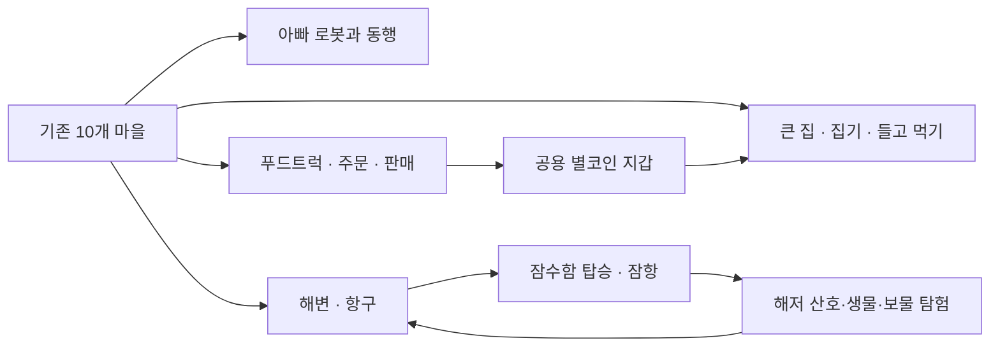

# 03. 생활형 오픈월드 경험 설계 — 제안안

> **PROPOSED / NOT IMPLEMENTED.** 코드 수준 아키텍처는 엔지니어링 검토와 별도 구현 승인 후 결정한다. 최우선 가치: 모든 사건이 **주인공이 움직이는 같은 월드 경험**에서 발생해야 한다.

## 한 장 경험 지도

위 그림의 구성은 **승인되지 않은 제품 경험 제안**이다. 화면 또는 API 수를 확정하지 않는다.

## 제품 결론: 별도 미니게임이 아닌 장소 기반 액션

- 현준이는 월드를 조이스틱으로 걷거나 자동차를 타고 돌아다니다가, 실제 푸드트럭 앞에서 메뉴와 손님을 만나고 음식을 판매한다.
- 집은 멀리서 볼 수 있는 대형 건물이며, 문에서 진입하면 실제 인테리어 공간에서 물건을 집고, 들고 이동하고, 먹는 표현까지 직접 체험한다.
- 바다는 현재 호수와 다른 넓은 영역이다. 주인공이 해변·항구로 가서 잠수함에 탑승한 뒤 깊이에 따라 변하는 해저 환경을 탐험한다. 잠수함 탑승/하차/복귀가 자연스럽게 이어진다.
- 아빠 로봇은 현준이 복제 캐릭터가 아니라 분명히 다른 실루엣과 기능을 가진 별도의 존재다.
- 일반 카드 메뉴나 '미니게임 시작' 버튼으로 모든 행동을 대체하지 않는다. 음식 선택에 필요한 **현장 주문 메뉴는 예외적으로 허용**된다.

## 체험 흐름 예시

1. 현준이가 집 앞에 서면 문이 눈에 보이고 '들어가기' 맥락 액션이 나온다.
2. 집 안 부엌 식탁에서 음식을 집으면 손에 음식 그래픽이 나타난다. 먹으면 식탁/보유 상태가 일관되게 바뀐다.
3. 아빠 로봇을 만나 인사하거나 동행한다. 따라오기/집에 머무르기 기능은 **옵션**이며 미확정.
4. 집에서 걸어서 푸드트럭에 도착한다. 주문 손님이 나타나고, 현준이는 표시된 메뉴를 선택해 판매한다.
5. 별코인 보상이 기존 공용 지갑에 표시된다. 트럭을 닫고 나가도 기존 주머니가 유지된다.
6. 해변 표지판을 따라 걸어 항구로 이동한다. 배경이 바다로 자연스럽게 이어진다.
7. 잠수함에 탑승해 하강하고 물고기·산호·탐험 지점을 지나 다시 항구로 돌아온다.
8. 신고 전화가 오면 종전처럼 월드 안에서 출동할 수 있고, 새로운 상호작용과 입력이 충돌하지 않는다.

## 월드 구조 대안 비교

| 선택지 | 장점 | 단점·리스크 | 현재 권고 |
| --- | --- | --- | --- |
| A. 현재 5600×1800 맵 오른쪽으로 단순 연장 | 처음 이해하기 쉬움 | 모든 지형 SVG·충돌·카메라를 크게 바꿔 성능/회귀 위험 | 초기 핵심 방식으로 단정하지 않음 |
| B. **이어지는 구역(마을 ↔ 해변 ↔ 수중)을 같은 탐험 경험처럼 전환** | 구역별 부하 조절, 확장 용이 | 전환 시 위치/동료/탈것/입력 상태 계약 필요 | **우선 기술 검토할 안** |
| C. 바다를 기존 호수의 색깔만 바꿔 재활용 | 구현이 빠름 | 현준이가 요구한 큰 바다·잠수함·해저 월드가 아님 | 거절 |
| D. 별도 미니게임 화면으로 바다를 떼어냄 | 기존 미니게임 구조 재사용 쉬움 | '맵에서 바로'라는 명시적 사용자 요구 위반 | 거절 |

B는 내부 구역 전환이 있을 수 있어도 아이에게는 **끊기지 않는 큰 세상**으로 보이게 해야 한다. 구현 엔진 선택은 아직 LOCKED 아님.

## 캐릭터·탈것 기준

- 신규 차는 기존 100종의 이름만 늘리는 게 아니라 **형태·탑승 동작·고유 행동**이 구별되어야 한다.
- 푸드트럭은 '가게이면서 탈것'으로 인식 가능해야 한다. 실제 트럭을 운전할 것인지, 세워진 상점만 원하는지는 OPEN.
- 잠수함은 물 위와 물속 위치 변화, 탑승 시 모습 변화, 해저 이동 제어가 명확히 느껴져야 한다.
- 아빠 로봇의 외형·기능·이름/대사는 차후 사용자 선택을 받되, 사용자의 사진이나 개인정보에 의존하지 않는다.

## 경험 품질 / 아동 친화 제약

- 이동은 왼쪽 고정 조이스틱, 행동은 오른쪽 단일 맥락 액션 우선; 방을 들어갈 때마다 키보드를 보여주지 않는다.
- NPC/음식/입구/차량의 크기는 화면에서 손가락으로 선택 가능한 수준인지 실제 화면으로 검증한다.
- 각 행동은 소리 없이도 상태 변화가 시각적으로 보여야 한다.
- 아이가 장사를 실패하거나 해저에서 길을 잃더라도 진행 기록을 잃지 않고 복귀할 수 있어야 한다.
- 큰 바다 화면은 넓게 느껴지되, 목적지 찾기/맵 북마크 등 이동 힌트가 필요하다.
- 실제 돈 결제, 광고, 현장 구조/응급처치 방법을 가르치는 방식은 포함하지 않는다.

## 가장 작은 가치 검증 웨지

**'집 → 로봇 → 푸드트럭 1회 판매 → 해변 → 잠수함 잠항 → 다시 집'을 같은 탐험 흐름으로 체험**할 수 있는 단일 연결 세션을 제안한다. 이 웨지로 월드의 실재감·조작 연속성·지갑 일관성을 함께 검증한다.

검증 시 1) 아이가 보호자 설명 없이 목적지에 다다르는지, 2) '눌러서 메뉴만 여는 게임'이라는 불만이 해소되는지, 3) 주행·판매·수중 탐험 간 조작이 끊기는지를 관찰한다. 목표 수치와 시험 인원은 **보호자와 합의 전 UNKNOWN**.

## 아직 결정하지 않을 것

집의 층수·방 수, 로봇의 AI/동행 방식, 해저 깊이 수치, 메뉴 가격·손님 수·월드 추가 픽셀 크기, 자동차 추가 대수는 모두 미정으로 남긴다.

