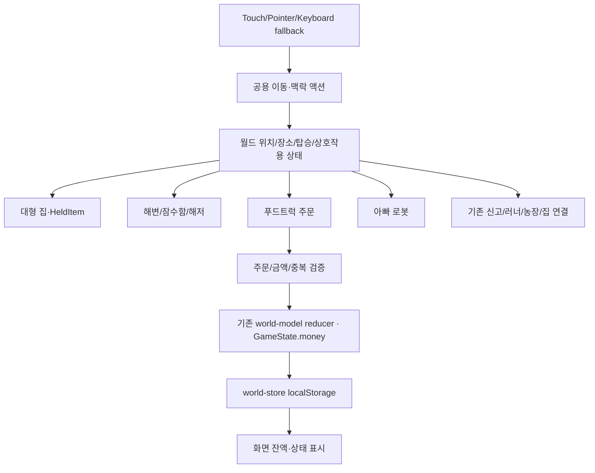

# 05. Engineering Review — 구현 전 승인 심사

> **Verdict: APPROVE_WITH_CONDITIONS for documentation-only discovery; BLOCKED for game implementation.**
> Confidence: high on current file map and existing Pages CI; medium on product UX choices; unverified real-device behavior.

## 1. Scope and assumptions

- **FACT:** 5600×1800 단일 기본 월드, 100종(10×10) 차고, 호수 잠수, 긴급 신고, 기존 가구 배치 페이지, 공용 별코인 지갑.
- **REQUEST:** 더 넓은 집/물건 들고 먹기, 아빠 로봇, 큰 바다, 잠수함, 푸드트럭 장사/기존 6메뉴 + 거대 음식, 추가 자동차.
- **PROPOSED:** 월드 연결 웨지 1개를 먼저 검증하며 기존 러너/농장/집/신고 기능은 유지.
- **UNKNOWN:** 로봇 역할, 비상 관련 발화, 추가 자동차 양/종류, 바다 구현 스코프, 푸드트럭 세부 거래/가격.

## 2. Architecture and data flow (review candidate, not final design)

- **System of Record:** 현행 공용 `world-model.ts`의 단일 GameState, 브라우저 세이브. 주문·위치 등 무엇을 저장할지 별도 결정.
- **Sync:** 이동·영업 주문 액션은 즉시 화면 피드백. **Async:** Pages 배포·브라우저 저장 I/O·향후 선택 가능 리소스 로딩.
- **External dependencies:** 정적 GitHub Pages, 브라우저 localStorage/입력/오디오; 실제 결제/외부 DB/API는 포함하지 않음.
- **핵심 충돌:** 현재 `House.tsx`는 별도 라우트이고, `Village.tsx`가 맵/신고/잠수 등 많은 상태를 소유한다. 완전 무중단 상태 흐름을 위한 상태 소유권 경계는 기술 결정 필요.

## 3. State and data contract (candidate)

| 항목 | 상태/ID | 진입·종료 | 영속 여부 |
| --- | --- | --- | --- |
| 장소 | `regionId`, `position` | 월드 ↔ 해변 ↔ 해저 ↔ 집 | 결정 필요 |
| 이동 | `onFoot / driving / submarine / diving` | 탑승·하차/입수·복귀 | 안전한 기본값 필수 |
| 아빠 로봇 | `robotId`, `followMode` | 만나기 ↔ 동행 ↔ 대기 | 동행 범위 미정 |
| 음식 | `foodId`, `heldItem` | 바닥/선반 ↔ 손 ↔ 먹기/전달 | 세션 또는 저장 결정 |
| 주문 | `orderId`, `transactionId`, `status` | 주문 → 준비 → 전달/취소 | 중복 보상 방지 기록 필요 |
| 잔액 | 기존 `money` | 판매 보상 → 공동 지갑 | 기존 v2 호환 유지 |
| 긴급 신고 | 현행 `reported / dispatched / resolved` | 발생 → 출동 → 해결 | 새 활동과 충돌하지 않을 것 |

ID는 중복되지 않는 게임 식별자여야 한다. 유저 실명·주소·연락처를 ID로 쓰지 않는다.

## 4. Failure paths

| Trigger | 기대 동작 및 화면 피드백 | 데이터 복구 |
| --- | --- | --- |
| 없는 맵 구역으로 이동 | 현재 위치 유지, 해변/마을로 복귀 안내 | 마지막 유효 위치 |
| 해저 밖 잘못된 좌표/차량 하차 | 바다 출구·항구로 안전 복귀 | 저장 검증 후 복귀 |
| 잠수 중 전화 신고 도착 | 알림이 잠수를 가리지 않거나 추후 확인 가능 | 현재 행동 중단/대기 정책 필요 |
| 판매 더블탭/중복 reducer dispatch | 한 번만 지급, 성공 표시 한 번 | 거래 ID 멱등성 |
| 돈/음식/주문 상태 잘못됨 | 주문 진행 거절, 이해 가능한 텍스트/아이콘 | 기존 지갑 유지 |
| 저장 실패·차단·quota exceeded | 세션 지속, 저장 경고 | 복구 수단 + 백업 정책 검토 |
| 오래된 v1/v2 save 로드 | 필드 기본값/경계 검사 | 기존 기록 보존 |
| 로봇이 장애물 뒤에 갇힘 | 안전 지점 복귀 또는 순간 이동 보정 | 진행 멈춤 방지 |
| 배포 JS 로드 실패/404 | 화면 오류·Actions 원인 확인 | 이전 검증 SHA로 rollback 계획 |
| 저사양 태블릿에서 프레임 급락 | 지역 렌더/이미지 비용 축소 | 렌더링 모니터링 및 차단 게이트 |

## 5. Security and operations

- **권한:** 브라우저 단독 게임; 관리자·실제 개인 계정 없음. 새 결제/외부 호출/사용자 사진 업로드를 임의 도입하지 않는다.
- **민감정보:** GitHub Pages는 공개 접근 가능하므로 실제 사용자 신상정보·사진·위치/로그·토큰을 넣지 않는다.
- **비용/용량:** SVG 재사용 우선. 큰 지도·해저 애니메이션·100+ 탈것은 초기 로드·메모리·프레임을 실측해야 한다.
- **관측성:** CI는 test/lint/tsc/build, 사용성은 실기기 화면·터치/펜 영상 또는 사람이 작성한 수동 검증표로 별도 관리한다. 개인 기기의 데이터/영상 공유는 선택이며 필수화하지 않는다.
- **배포:** PR branch에서 검증 → 승인 → main merge → Pages Actions 성공 → 실제 기기 UAT.
- **롤백:** Git 이력 덮어쓰기 금지. 실패하면 수정 PR 또는 승인된 안전한 revert 커밋.

## 6. Requirement → test matrix

| Req | Fixture/level | Assert / threshold |
| --- | --- | --- |
| HW-003/004 | 큰 집 진입/집기/먹기 순환의 UAT | 집에 들어가 음식 들기/이동/먹기가 연속 작동 |
| HW-005/006 | region bounds·잠수 전환 unit + 브라우저 | 육지↔해변↔잠항↔수면 복귀, 막힌 위치 없음 |
| HW-002 | 동료 상태 unit + 월드 실기기 | 아빠 로봇 시인성, 캐릭터 복제 아님, 조작 방해 없음 |
| HW-007~011 | 주문/아이템/정산 reducer unit | 모든 요청 메뉴 확인, 1주문 = 1정산 |
| HW-008 | 동일 transactionId 재실행 | 돈이 두 번 늘지 않음 |
| HWP-001/003 | 360/390px 및 태블릿, pointer·pen | 추가 별도 미니게임 이동 없이 접근·행동 가능 |
| 기존 퇴행 | runner/farm/house/vehicle/emergency CI | 모든 종전 테스트 PASS + 수동 주행 UAT |
| 저장 호환성 | v1/v2 fixtures, corrupt/quota test | 기존 잔액/가구/기록 보존, 장애 시 안내 |
| GitHub Pages | PR CI + main deploy | tests/types/lint/both builds 성공, 실제 URL 열기 별도 |

**정량 목표:** 어린이의 독립적인 플레이 완료율, 연속 체험 길이, 프레임/FPS 기기별 하한은 보호자·환경 조사 전 `TBD`. 측정 없이 '쾌적' 합격 주장 금지.

## 7. Decisions

- **LOCKED:** 기존 10개 마을/100차량/신고·러너·농장·집 파괴 금지; 월드에서 직접 행동; touch/pen 우선; 기존 coin 보존; 실제 결제·민감자료 미도입.
- **NEEDS_OWNER:** [08_DECISIONS.md](08_DECISIONS.md)의 D-01~D-10 — 보호자가 사용자 의도 확인.
- **DEFERRED:** 서버, 로그인, 온라인 장사, 실사용 음성 인식, NPC 생성형 AI, 실제 결제.

## 8. Approval gate

1. HWQ 불명확 항목 중 1차 구현을 가로막는 결정을 확정.
2. 기존 10마을/월드/자동차/집과 신규 지역의 공존/저장 소유권 계약 리뷰.
3. 푸드트럭의 주문·매출 원자성·중복 지급 방지와 세이브 마이그레이션 결정.
4. 큰 바다/잠수함/집의 탑승·진입·복귀·유실 상태 수락 시나리오 확인.
5. 저사양 태블릿/삼성 브라우저/S Pen 및 Pages 운영 검증 기준 확정.
6. 사용자로부터 별도의 명시적 **게임 구현 승인**을 받아야 코드/에셋/라우트 구현을 시작한다.

현재 문서 승인 자체가 구현 승인으로 전이되지 않는다.

