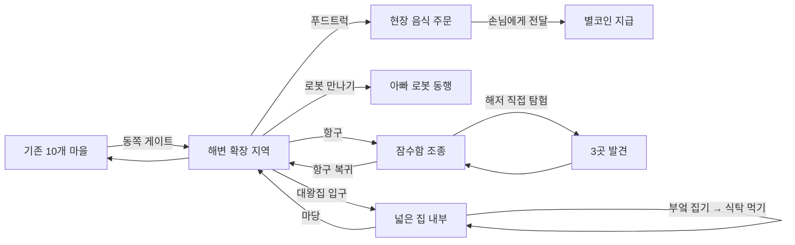

# 09. 생활형 오픈월드 확장 — 구현 결과·검증·인수인계 기록

> 작성: 2026-10-11 Asia/Seoul. 기준: `PR #15` (`feat/hyunjun-open-world-life-ocean-foodtruck-20261011`).
> **구분:** 이번 문서는 요구사항 v0.1.0 이후 실제 코드에 추가한 결과를 설명한다. 초기 01~08의 FACT/REQUEST/PROPOSED/UNKNOWN 기록은 해당 시점의 조사 자료로 유지한다.

## 1. 구현된 범위 (CODE)

| 요구 ID | 구현 현황 | 코드 위치 | 한계 |
| --- | --- | --- | --- |
| HW-001 자동차 더 | 기존 100종 유지 + **푸드트럭 10종, 리무진 10종 = 120종**. 별도 실루엣과 색상 조합 | `src/game/cars.ts`, `CarArt.tsx`, `Garage.tsx`, `cars.test.ts` | 12개 차체 계열×10색; 120개의 독립 차량 물리 모델은 아님 |
| HW-002 아빠 로봇 | 해변 마을에 고유 로봇 외형 NPC, 근처에서 '따라오기/쉬기', 동행 시 주인공 옆에 표시 | `LifeWorldScene.tsx`, `Village.tsx` | 별도 생성형 AI/자율 길찾기 없음 |
| HW-003 큰 집 | 새 해안 지역에 크게 보이는 집 외관, 동일 화면의 대형 실내 구역(부엌/식당/침실/놀이방)에서 조이스틱 이동 | `life-world.ts`, `LifeWorldScene.tsx`, `Village.tsx` | 기존 `/house`의 6개 가구 꾸미기 화면은 그대로 유지; 대형 실내의 가구 편집은 후속 |
| HW-004 들기/먹기 | 대형 집 부엌에서 피자를 집어 들고 이동; 식탁에 도달하면 먹는 행동, 보유 상태 제거 | `Village.tsx`, `LifeWorldScene.tsx` | 음식은 대표 피자 1종만 직접 집기; 다양한 집 음식은 후속 |
| HW-005 큰 바다 | 기존 10개 마을 동쪽 이동 게이트 → 3800×1800 해안 지역 → 항구; 되돌아오는 입구 | `life-world.ts`, `LifeWorldScene.tsx`, `Village.tsx` | 외부 구조는 지역 간 전환; 한 장의 단일 거대 물리 맵 아님 |
| HW-006 잠수함 | 실제 항구 위치에서 잠수함 탑승, 별도 4200×1800 해저 구역 직접 운전, 산호·불가사리·황금 조개 3개 발견, 안전한 항구 복귀 | `life-world.ts`, `LifeWorldScene.tsx`, `Village.tsx` | 잠수함 내부 방/깊이 조작/해양 생물 AI 없음 |
| HW-007 푸드트럭 | 해안 마을에 실제 트럭 배치, 가까이 가서 현장 주문 메뉴 열기, 준비 후 걸어서 손님에게 전달 | `LifeWorldScene.tsx`, `Village.tsx`, `life-world.ts` | 트럭 자체를 몰아 영업 장소를 옮기는 시스템은 추후 과제 |
| HW-008 돈 버는 장사 | 성공 주문 ID가 재처리되면 무시하는 공용 `money` 별코인 정산, 최대 상한 검증 | `src/lib/world-model.ts`, `world-model.test.ts` | 게임 내 가상 화폐만, 실제 거래 없음 |
| HW-009~011 요청 메뉴 | 돈까스·김치·피자·콜라·대왕 피자·초대형 황금 피자. 크기/가격/표시가 다른 카드 | `life-world.ts`, `Village.tsx` | 큰 메뉴의 그래픽은 SVG/이모지 기반 1차 표현 |
| HW-012 특별 메뉴 | 제안 2종: 공룡 햄버거, 대왕 아이스크림 | `life-world.ts` | 요청 원문에서 종류를 지정하지 않았으므로 제안 구현/변경 가능 |

## 2. 플레이 흐름 (동일 게임 Shell / 조이스틱)

- **기존 마을 유지:** 러너/농장/집 꾸미기, 구조 신고/차량 100개 원본, 호수 잠수·캠핑 코드를 제거하지 않았다.
- **이동 UX:** 공용 `Joystick` / `useMovement`로 계속 직접 이동하며 오른쪽 액션 버튼은 현재 가까운 장소에 따라 맥락적으로 변한다.
- **보조 이동:** 상단 '큰 바다·대왕집' 진입 버튼과 지역 귀환/지도 버튼은 아이의 길 찾기를 돕는 선택 도구; 본체는 월드 내 건물/목적지에서 행동한다.

## 3. 경제 및 호환성

- 기존 세이브 버전 **v2**와 `hyunjun-game-v2` 키 유지. 이전 `hyunjun-game-v1`/runner 기록 읽기 경로를 변경하지 않음.
- 기존 `money` 지갑 보존. 게임 재시작 시 새 필드가 없는 저장도 `migrateSave()`에서 빈 기록으로 복원.
- 신규 필드 `settledFoodSales: string[]`, `visitedSeaTreasures: string[]`를 기존 게임 상태에 추가하여 주문/보물 정산 멱등화.
- 음식 거래 ID는 브라우저 고유 UUID(사용 불가 환경에서는 대체 ID)로 생성. 반복 탭을 로컬 입력 가드와 reducer 멱등성 둘 다 막음.
- 손님 주문이 완료된 음식만 근처 손님에게 전달 가능; 일반 '메뉴 열기'만으로 별코인을 얻지 못함.
- 잘못된 음식 ID, 이미 지급한 주문 ID, 존재하지 않는 수중 발견 ID는 reducer가 무시.
- **한계:** 장사를 준비 중인 주문/든 음식, 로봇 동행/현재 지역/잠수함 탑승은 React 세션 상태이며 새로고침 시 위치/진행 상태를 복원하지 않는다. 별코인과 완료 거래/발견 보상만 영속적으로 보존한다.

## 4. 검증 근거

| 확인 대상 | 상태 | 출처 |
| --- | --- | --- |
| 새 월드 영역/메뉴/이동/보물 순수 함수 테스트 | CODE 추가 | `src/game/life-world.test.ts` |
| 기존 100종 유지 + 새 20종 차고 회귀 | CODE 추가·수정 | `src/game/cars.test.ts` |
| 판매 재시도/유효성·저장 마이그레이션·수중 중복 보상 | CODE 추가 | `src/lib/world-model.test.ts` |
| 원래 러너/농장/집/구조/조이스틱 유닛 테스트 | 기존 테스트 유지 | `src/game/*.test.ts`, `src/lib/*.test.ts` |
| 초기 코드 구성의 PR CI/Pages 빌드 | **PASS** (PR source SHA `5a7383f`) | [Game CI](https://github.com/haapy-mind-life/carrot-racer-farm/actions/runs/38107537290) / [Pages build](https://github.com/haapy-mind-life/carrot-racer-farm/actions/runs/38107537287) |
| 최종 문서 포함 PR HEAD CI 및 `main` 배포 | 최종 Actions 결과 별도 확인 필요 | [PR #15](https://github.com/haapy-mind-life/carrot-racer-farm/pull/15) |
| 실기기 Samsung Browser/S Pen 동작 | **NOT RUN** | `06_ACCEPTANCE_AND_UAT.md` 절차 |
| 어린이 직접 플레이/재미·성능 검증 | **NOT RUN** | 현준이/보호자 검증 필요 |

## 5. 아직 남은 결정·품질 작업

1. '비상도'의 정확한 의미, 아빠 로봇 세부 인격/대화, 추가 탈것 기대 수량은 현준이 확인 전 **UNKNOWN**을 유지한다.
2. 해저/대형 집을 실제 삼성 브라우저와 S Pen으로 테스트하고, 터치·펜·저사양 성능 및 모바일 HUD 겹침을 관찰한다.
3. 푸드트럭 주문/들고 있는 음식/월드 위치/로봇 동행의 **세션 간 복원 정책**은 다음 설계에서 결정한다.
4. 대형 집 가구 직접 배치, 푸드트럭 주차·직접 운전 영업, 잠수함 내부 조종/해양 생물 반응, 추가 대형 메뉴 시각 품질 고도화는 향후 개선.
5. 현준이가 '버튼 눌러서 이동하는 게임'이라고 느끼지 않는지, 월드 내 직접 이동/행동이 충분히 체감되는지 UAT 필요.

## 6. 후속 에이전트 작업 가이드

- 현재 main으로 새로 fetch하여 **PR #15 병합 및 배포 성공 여부** 확인. 이 문서에 오래된 SHA가 있어도 그 시점의 검증 증거로 취급.
- `MEMORY.md` → `docs/README.md` → 본 문서 → `06_ACCEPTANCE_AND_UAT.md` → `08_DECISIONS.md` 순으로 읽고 다음 변경.
- 구현 완료와 실제 사용자 플레이 합격을 혼동하지 않는다. 10개 마을 및 저장 호환성 파괴 금지, 브라우저 입력 안정성/월드 내 동작 우선.
