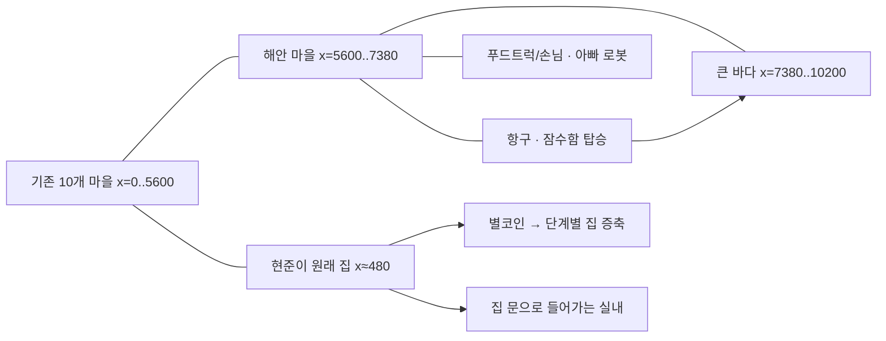

# 10. 현준이 게임 — 통합 월드·큰 바다·우리 집 증축 재구현 기록

> 작성: 2026-10-11. 기준 PR: [#17](https://github.com/haapy-mind-life/carrot-racer-farm/pull/17).
> 사용자 수정 요구로 이전 #15의 **별도 해안·해저 화면 방식은 잘못된 사용자 경험**으로 판정했다.
> 본 문서는 코드 변경의 설계 근거와 검증 기록이다. GitHub Pages/실기기 확인은 각각 별도 상태로 관리한다.

## 1. 오류 원인과 해결 원칙

### AS-IS 문제점

- 이전 `Village.tsx`는 `region="coast"/"deep-sea"`로 전환하면서 기존 5600px 월드 대신 별도 3800px 화면과 4200px 화면을 그렸다.
- 이전 해변 장면의 물은 x=3320~3800 (약 480px 폭)에 불과해, 사용자가 기대한 **크고 실제 탐험 가능한 바다**로 보기 어려웠다.
- '대왕집'은 기존 현준이 집(x=480 부근)이 아닌 해변의 별도 건물이었다. 별코인으로 원래 집을 키우는 계약 자체가 없었다.

### TO-BE: 이 PR의 변경

- **같은 외부 월드:** 모든 마을, 해안, 푸드트럭, 로봇, 잠수함 항구, 큰 바다는 `MAP.width=10200`의 **공통 좌표와 카메라·조이스틱**을 사용한다. 해안 이동을 위해 화면/region을 바꾸지 않는다.
- **내부 공간 예외:** 집 안은 원래 집 앞에서 문을 통해 들어가는 **실내 장면**이다. 기존 외부 마을과 해안의 별도 세계를 만든 것이 아니다.
- 기존 월드의 가장자리 x=5600에서 wrap하여 x=0으로 순간 이동하던 동작을 제거했다. 이 수정에 맞춰 과거 wrap-around 테스트를 업데이트했다.
- **지형:** 녹지·도로와 해변 x=5600..7380, 큰 바다 x=7380..10200을 이어 렌더링한다. 바다에는 파도, 넓은 수면, 산호, 물고기, 해양 생물 및 보물 좌표를 둔다.
- **잠수함:** 항구에서 잠수함 탑승, 같은 외부 지도에서 실제 좌표 이동, 잠항 버튼으로 수면/수중 시각 상태 전환, 바닷속 발견 3곳, 항구 복귀.
- **집 성장:** 원래 마을 집에 1~4레벨 적용. `GameState.houseTier`가 외관 및 실내 공간 잠금/해제에 반영되며, 별코인을 벌어 다음 레벨로 증축한다.

## 2. 주요 좌표 및 가격 (현재 코드 설정)

| 영역/목적지 | 좌표/범위 | 비고 |
| --- | --- | --- |
| 기존 마을 | x=0..5600 | 기존 10개 마을 및 러너/농장/긴급 출동 유지 |
| 해변 거리 | x=5600..7380 | 원래 길에서 직접 걸어 이동 |
| 푸드트럭 | (6310,920) | 손님 (6640,1120)에게 직접 배달·판매 |
| 아빠 로봇 | (5950,1230) | 주인공과 달라 보이는 로봇 NPC |
| 잠수함 항구 | (7330,1010) | 행동 버튼으로 승선, 바다에 진입 |
| 큰 바다 | x=7380..10200 | 잠수함 전용 조종 경계 및 수중 생물/보물 |
| 바닷속 발견 | (7950,560), (8760,1220), (9600,660) | 기존 `explore-sea` 멱등성 별코인 보상 |
| 원래 현준이 집 | (480,565) | 별도 해변 대저택을 성장 집으로 오인하지 않음 |

| 주택 레벨 | 명칭 | 이전 레벨에서 올리는 비용 |
| --- | --- | --- |
| 1 | 아담한 집 | 기본 시작 |
| 2 | 넓은 2층 집 | 100 별코인 |
| 3 | 멋진 대저택 | 350 별코인 |
| 4 | 현준이 성 | 850 별코인 |

상기 비용은 플레이 가능한 최초 밸런스 설정이다. 현준이의 재미와 실제 플레이 템포에 따라 추후 조정할 수 있다.

## 3. 경제·저장 안전성

- 별코인 수입 원천은 기존 푸드트럭 판매/농장/러너/보물 발견을 그대로 활용한다.
- `upgrade-house`는 순차적으로 레벨을 **한 단계씩**, 잔액이 충분할 때만 진행하며 구매 금액을 1회 차감한다.
- 저장 v2와 `hyunjun-game-v2` 키 유지; 기존 저장에 `houseTier`가 없으면 1로 안전하게 읽어 기존 코인/러너/가구를 삭제하지 않는다.
- 잘못된 houseTier 저장 값은 기본값으로 정규화한다.
- 현재 집 안에서 들고 먹기, 푸드트럭 영업, 구급/소방·경찰 미션, 120종 차고 등 기존 기능은 유지한다.

## 4. 변경 파일 / 검증

- 월드 경계/카메라: `src/game/adventure.ts`, `src/game/adventure.test.ts`, `src/game/touch-world.test.ts`.
- 통합 지형·차량·보물 위치/이동: `src/game/unified-world.ts`, `src/game/unified-world.test.ts`.
- 실제 월드 오버레이 및 집 성장 그래픽: `src/components/hyunjun/UnifiedCoast.tsx`, `LifeWorldScene.tsx`, `adventure.css`.
- 플레이어 이동/탑승/푸드트럭/집 입장/증축: `src/components/hyunjun/Village.tsx`.
- 공유 저장: `src/lib/world-model.ts`, `src/lib/world-model.test.ts`.
- GitHub PR: https://github.com/haapy-mind-life/carrot-racer-farm/pull/17

### 검증 게이트

| 검증 항목 | 현황 |
| --- | --- |
| TDD/단위 테스트 | 신규 통합 경계·주택 경제 회귀 테스트 추가; PR CI로 최종 확인 |
| TypeScript / ESLint / Pages build | PR Actions에서 별도 확인 |
| main 병합 / Pages 배포 | 성공 여부를 병합 후 해당 run에서 확인 |
| 실제 Samsung Browser/S Pen 화면/이동 | NOT RUN |
| 현준이 체험 UAT | NOT RUN |

## 5. 실사용 검증 시나리오

1. 원래 마을에서 지도 x=5600 방향으로 직접 이동 → 장면 전환 없이 해안 거리에 도착 → 푸드트럭과 손님 확인.
2. 푸드트럭 메뉴 선택 → 손님에게 전달 → **별코인 증가** → 원래 현준이 집 앞까지 되돌아가기.
3. 집 앞에서 `우리 집 확장` 버튼을 이용해 돈을 지불 → 같은 자리에 집 모양/레벨 변화 → 새로고침 뒤 유지 확인.
4. 해변에서 항구로 이동 → 노란 잠수함 승선 → 바다 안에서 조이스틱 이동 → 잠항 시 물속 풍경 변화 → 바닷속 보물 발견 후 항구 복귀.
5. 이전 소방/경찰/구급, 자동차 120종, 러너·농장·원래 집 꾸미기, 별코인 저장 회귀.

**중요:** GitHub Actions 성공만으로 실제 기기 화면, 잠수 조작, 고성능 렌더링 및 아동의 플레이 적합성이 확인되지는 않는다. 실기기 UAT가 끝나기 전에는 DEVICE PASS라고 보고하지 않는다.

## 6. 구현 완료 후 GitHub Pages 검증 영수증

기능 PR #17의 최종 병합 커밋은 `a57bc204eeac6a5295f612733a9df235b8b5ca72`다.

| 검증 단계 | 상태 | 증거 |
| --- | --- | --- |
| CODE | **DONE** | [PR #17 merged](https://github.com/haapy-mind-life/carrot-racer-farm/pull/17) |
| Unit / TypeScript / ESLint | **PASS** | [Hyunjun Game CI 38108873838](https://github.com/haapy-mind-life/carrot-racer-farm/actions/runs/38108873838) |
| PR 정적 Pages 빌드 | **PASS** | [Pages build 38108873839](https://github.com/haapy-mind-life/carrot-racer-farm/actions/runs/38108873839) |
| main Pages 빌드 및 배포 | **SUCCESS** | [main run 38108912871](https://github.com/haapy-mind-life/carrot-racer-farm/actions/runs/38108912871) |
| 게임 주소 | 배포 작업 성공 | https://haapy-mind-life.github.io/carrot-racer-farm/ |
| 삼성 브라우저/S Pen 실사용 | **NOT RUN** | 보호자/현준이가 실제 기기에서 월드·바다·잠수함·증축/푸드트럭 UAT 필요 |

배포 Job 성공은 정적 파일 배포 결과이며 게임 화면 렌더·바다 실제 표시·버튼 사용성 또는 프레임 안정성을 **직접 시각 검증한 증거가 아니다**. 아이가 게임에서 `해변 안내`로 같은 지도의 x≈6180에 이동한 뒤 직접 해안과 항구를 탐험하고 잠수·증축·판매할 수 있는지 확인한다.
