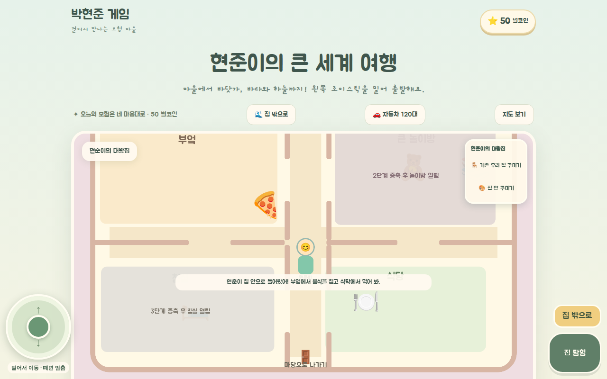
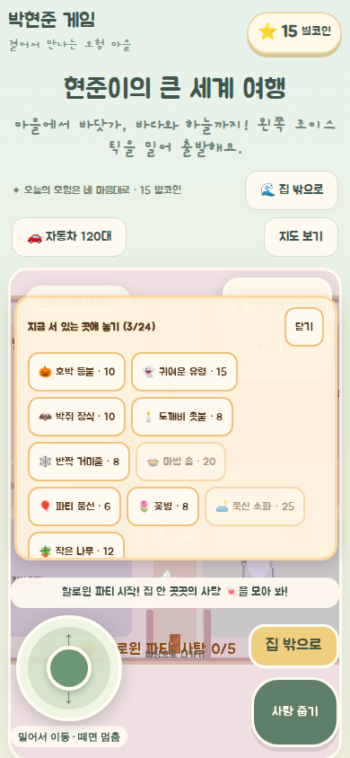

# 실내 공간 수정 · 2026-10-17

- 원인: 입장 좌표가 증축 전 침실 안에 있었고, 실외와 같은 배율로 방 일부만 크게 보였다. 벽은 문 없이 그려졌으며 이동은 외벽 밖까지 허용됐다.
- 조치: 현관 복도로 입장, 실내 전용 배율, 실제 출입구와 일치하는 벽 충돌, 증축 단계별 방 진입 제한. 현관 출구와 버튼 문구 정리, 안내창 축소, 모바일 꾸미기 패널과 조작 안내 겹침 해소.
- 증축 전에도 파티를 끝낼 수 있도록 잠긴 방의 사탕은 복도에 표시한다. 사탕 ID·보상·저장 형식은 유지한다.
- 검증: 단위 테스트 63개, TypeScript, 변경 파일 ESLint, Pages 빌드 통과. 모든 집 단계의 부엌·식당·출구·사탕 도달 경로 검사 포함.
- headless Chromium: 1280×800, 390×844. 집 입장 → 방 이동 → 피자 집기/먹기 → 퇴장/재입장 → 장식 배치 → 파티 시작 확인. 가로 넘침·브라우저 오류 없음.
- 실제 기기 터치·S Pen UAT 및 배포는 미실행.

